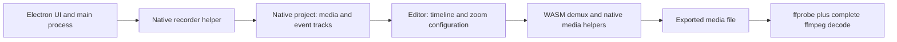

# Electron and native recording boundaries

The inspected Screen Studio build combined an Electron application with native
recording and media helpers. This is a functional map of the observed workflow,
not a recovered vendor source tree or a complete call graph.

## Resource loading

The original resources were packaged as ASAR with unpacked native dependencies.
During the isolated experiment, a custom asset-protocol request for the demuxer
WASM failed in the packed layout. Expanding resources while preserving file bytes
resolved that particular test failure. Extraction also required restoring
executable modes for helpers; default 0644 modes caused later export trouble.
This is an observed workaround for one setup, not a general ASAR requirement.

## Native capture and project data

The actual recording path used the application's native recorder, rather than an
imported external capture. Its project contained media plus separate mouse
position, mouse click and keystroke JSON tracks. Editing produced scene-level zoom
ranges. `project_stats.py` recognizes the observed list-based event schema and
the `project.json` scene representation, including its SuperJSON `json` wrapper.
It outputs counts only. Another version may have a different schema.

## Process-local isolation

The historical harness redirected application data paths before the main entry
point and restricted outbound access and writes for that process. A recorder
failure came from Foundation atomic writes under the user's temporary
`TemporaryItems/NSIRD_polyrecorder_*` area, which did not follow only `TMPDIR`.
A narrow process rule was required in that experiment. Global proxies, hosts and
Gatekeeper were not changed. No isolation launcher is distributed here.

## Export verification

The editor's completion message was insufficient: one failed attempt reported
completion without leaving the final file. Verification therefore checks the
actual finished file, its dimensions, duration and decoded frames, complete
video/audio decode, stable size/mtime identity and SHA-256. It does not establish
capture provenance, ownership, visual quality or authorization.
